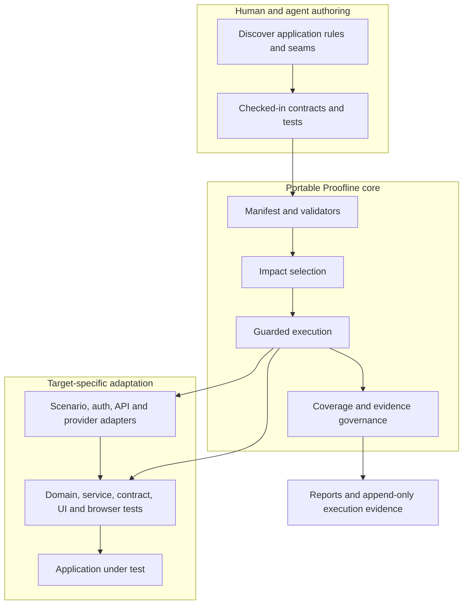
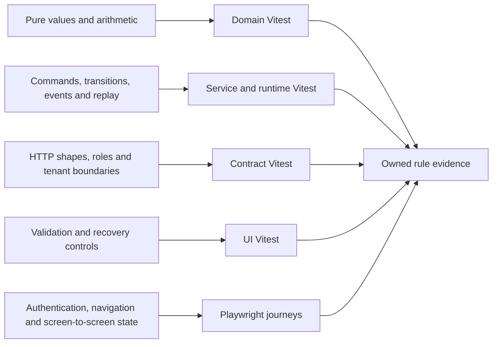
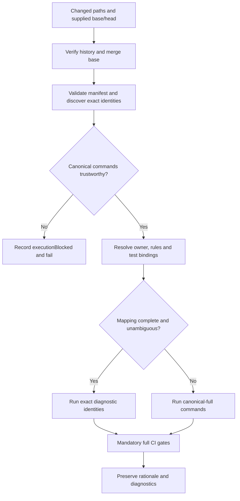
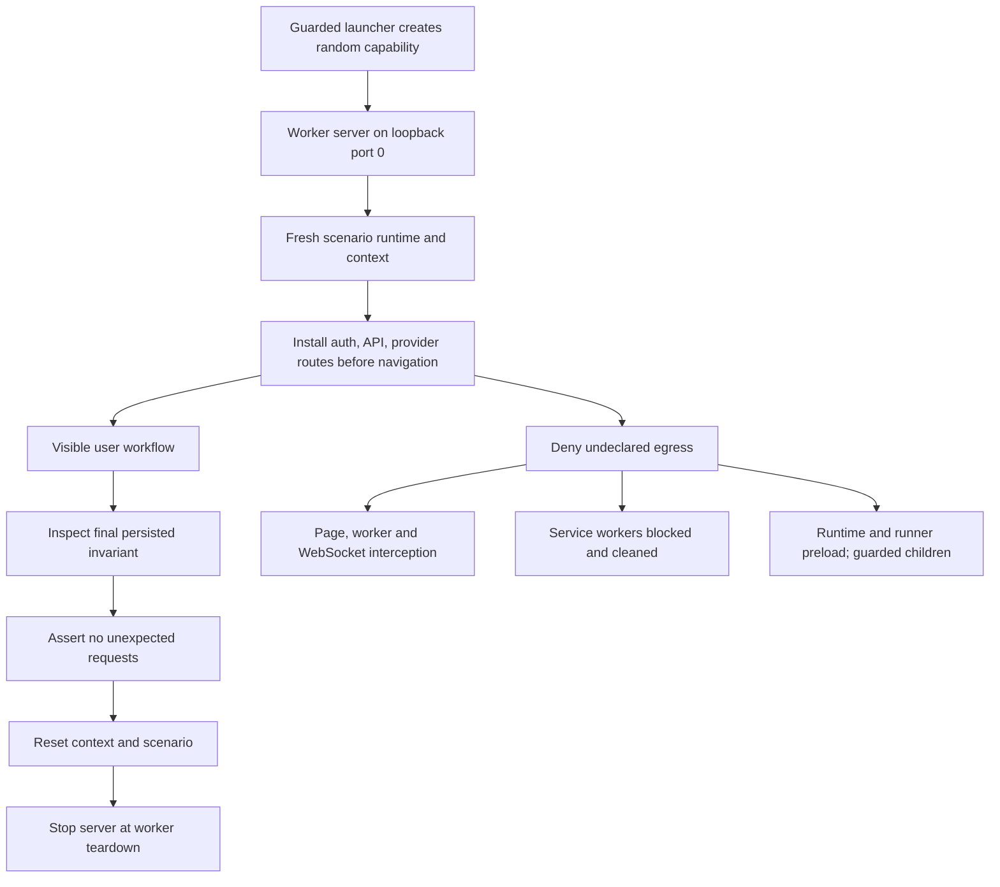

# Proofline technical guide

Companion to the [ten-slide browser presentation with regression and workflow demos](proofline-overview.html) and its [PDF copy](proofline-overview.pdf). This guide describes the implemented harness at tested snapshot **`4dc77a6`**, with verification pinned to base/merge base **`31b63c3`**. Documentation and demo captures created afterward are not covered by that historical gate.

## 1. What is portable

Proofline is a repository-native regression harness for React/Vite applications. An agent can help discover rules, implement behavior, author tests, and review mappings. Repeated execution belongs to deterministic Node, shell, JSON, Vitest, and Playwright commands; CI requires no agent, model call, hosted prompt, or provider credential.

The reusable assets are the manifest contract, validators, exact test selection, guarded execution, coverage/evidence governance, adapter lifecycle, and adaptation protocol. The insurance CRM demonstrates those assets. Its pages, policy rules, fixtures, service implementation, and tests must be replaced with the target application's equivalents.



The CRM reference currently declares **12 workspaces, 14 canonical command definitions, and 32 critical rules**. Those counts describe this snapshot, not requirements imposed on a new repository. Delivery is checked-in tooling and configuration; an npm package, hosted service, or IDE plugin is outside this increment. [Sources: design:5–46; manifest:3–209; rules registry](../superpowers/specs/2026-10-28-portable-hybrid-workflow-harness-design.md#L5), [manifest](../../proofline.harness.json#L3), [rules](../../test-impact/rules.json).

## 2. The contracts that make execution reviewable

`proofline.harness.json` is the executable authority. Version 1 declares structured `argv` and repository-relative `cwd`, workspace membership, canonical commands, browser projects/local origins, adapter paths, coverage groups, runtime ownership, and rule/test bindings. Lifecycle and golden-workflow matrices are separate versioned files referenced by the manifest.

Validation is static: it checks schema, paths, scripts/executables, workspace membership, ownership, and evidence metadata without executing configured commands. An empty browser command list needs an explicit opt-out reason. Each browser workspace names one discovery adapter; its worker and shard commands remain registered full gates.

An ownership binding identifies a rule, layer, stable binding ID, command key, runner, file, full title, and line; Playwright bindings may additionally name a tag. Discovery must establish an exact, unambiguous runnable identity. A file existing somewhere in the repository is insufficient proof.

Golden rows declare adapter-only setup, user actions, URL transitions, accessible visible assertions, final persisted invariants, rule IDs, and exact executable evidence. Bound specs consume that contract through a shared helper, so stale evidence or mismatched rules fail. Lifecycle rows describe state, operation, authority, result, next state, rules, and layer; stateless targets declare `lifecycleMatrix: null`. [Sources: schema:101–181](../../tools/impact/src/harness-manifest.ts#L101), [workflow binding:32–47](../../apps/crm-e2e/src/proofline/workflow-matrix.ts#L32).

## 3. Hybrid test ownership

The test layer follows the claim being proved. Browser tests are reserved for behavior that depends on the browser or a genuine journey across screens. Deterministic tests own permutations, boundaries, delivery, retries, and business calculations.



The reference runtime composes Policy, Policy State, Finance, and an in-memory service bus. Its checkpoint includes command receipts, envelopes, pending delivery, consumer receipts, generated IDs, and service state. Restoration builds the bus, registers normal subscribers, hydrates stores, and then permits replay. Tests exercise accepted-before-delivery and partial-consumer failures, proving that replay does not duplicate policies, projections, or ledger results. This is deterministic recovery evidence without a production database; a target must adapt its own persistence seam.

Customer/property intake uses the same stable command-identity discipline as quote, bind, and finance mutations. A lost response retains the command identity; a terminal rejection permits a new attempt. Tests cover runtime, API, and UI consequences. [Sources: ownership design:243–280](../superpowers/specs/2026-10-28-portable-hybrid-workflow-harness-design.md#L243), [runtime checkpoint:90–104](../../packages/insurance-runtime/src/runtime.ts#L90), [restore order:1101–1162](../../packages/insurance-runtime/src/runtime.ts#L1101), [recovery tests:31 onward](../../packages/insurance-runtime/src/runtime.test.ts#L31).

## 4. Selection accelerates diagnosis

Selection starts from requested Git revisions and resolves complete history, checkout identity, and a unique merge base. Raw Node hashing compares worktree bytes with Git object/index metadata. Reviewed Git subprocesses use restricted object/metadata operations, inert configuration, and no lazy fetch; worktree filters or external helpers cannot become hidden execution authority. Renames preserve deletion/addition evidence, and transformed content may broaden selection conservatively.



Configuration changes, structural changes, missing ownership, stale/deleted/ambiguous bindings, unsupported dynamic imports, new unmapped workspaces, or uncertain revisions select canonical-full when command authority is trustworthy. Invalid command metadata blocks dispatch instead. Static imports contribute additional evidence; they cannot substitute for cross-layer ownership.

`artifacts/impact/manifest.json` records requested/resolved revisions and changes. `discovery.json` and `selection.json` retain discovered identities, fallback reasons, and changed path → owner → rule → test rationale. Literal dynamic-import reasons preserve importer, specifier, resolved target, and owner. Exact diagnostics execute the declared identity rather than merely its containing project. Canonical-full enumerates registered commands, including scenario worker/shard gates; it is not a bounded file walk. [Sources: revision verification:45–97](../../tools/impact/src/governance.ts#L45), [selection:110–168 and 340–369](../../tools/impact/src/select.ts#L110), [blocked dispatch:349–408](../../tools/impact/src/main.ts#L349).

When investigating a failure, read revision authority first, then the selection reason, then the failing test's layer. An unresolved base explains a broad run; it does not prove that every application feature changed. A stale title explains invalid evidence; it does not justify deleting the binding. Repair the contract or implementation, rerun the relevant diagnostic, and retain the full gates. This ordering preserves the useful distinction between an application regression, a broken adaptation contract, and an execution failure. It also keeps an apparently fast selected pass from being mistaken for complete release evidence.

## 5. Scenario lifecycle and security

Each Playwright worker starts a separate test artifact server on an OS-assigned loopback port. The static server holds no mutable scenario state. Each scenario owns a fresh Test API/runtime and BrowserContext; additional contexts share that runtime only when the test explicitly requests them. No mutable fixture or browser storage crosses tests, workers, shards, or runs.



The launcher issues a random startup capability. The server rejects missing, incorrect, or replayed capabilities and binds only to numeric loopback. Auth/API/provider routes are installed at context scope before navigation; declared providers are deterministic fakes. Undeclared requests fail with plane, method, URL, scenario, and trace context. Unsupported required WebSocket interception fails closed. Cleanup aggregates request/body/reset errors, including after assertion failures.

Runner and runtime guards load before test/application modules. They cover fetch, HTTP(S), WebSocket, and inherited child execution. Child authority binds exact executables to reviewed purposes and argv; delegated policy cannot broaden parent authority. Arbitrary wrappers, nested package-manager execution, unsafe loaders/inspectors, and helper-capable Git operations are rejected. A new egress plane requires a guard and denial self-test before use.

Production uses `main.tsx`; test mode uses a separate entrypoint/build. Production audit requires module and Vite manifests and rejects test adapters, mocks, capability markers, and forbidden module references. This is an audited application boundary, not a runtime flag a production client can enable. [Sources: fixture lifecycle:20–30 and 93–135](../../apps/crm-e2e/src/fixtures/test.ts#L20), [context routing:469–520](../../apps/crm-e2e/src/fixtures/scenario.ts#L469), [capability server:23–83](../../tools/proofline/serve-test-app.mjs#L23), [production audit:44–90](../../tools/proofline/src/production-negative.ts#L44), [guard contract](../PORTABLE_TEST_AUTOMATION.md#L18).

## 6. Commands and workflow evidence

These are convenient entrypoints; the manifest remains the exact structured command contract. Revision-sensitive commands should receive explicit trusted `--base` and `--head` values.

| Command or workflow | Purpose and scope |
| --- | --- |
| `pnpm harness:validate` | Static portable contract validation; emits harness diagnostics. |
| `pnpm test:impacted -- --dry-run --base <base> --head <head>` | Explain selection and fallback before execution. |
| `pnpm test:impacted -- --base <base> --head <head>` | Execute exact diagnostics or registered canonical-full commands. |
| `pnpm test` / `pnpm e2e` | Full unit / Chromium suites. Unit builds production then test artifacts first; browser builds test artifacts first. |
| `pnpm coverage` / `pnpm coverage:check -- --base <base> --head <head>` | Produce reports; enforce compatible monotonic source-group ratchets. |
| `pnpm record:check -- --base <base> --head <head>` | Check append-only history, fresh scoped evidence, generated rules, and command documentation parity. |
| Flagship | Protected deep link → login → intake → quote/bind → policy/finance → logout → denied revisit. |
| Recovery / authority | Response-lost bind recovery; Viewer route/navigation denial; two-context shared-runtime tenant isolation. |
| Finance / smoke | Visible refund/correction; optional Firefox/WebKit invariant smoke. |

Adapters may establish fixtures and inspect final invariants. They cannot perform an in-scope user action. The flagship uses real navigation and visible controls before inspecting exactly one customer/property/quote/policy and matching projections/ledger. Chromium owns the complete matrix. [Sources: canonical commands](../PORTABLE_TEST_AUTOMATION.md#L34), [build prerequisites:238–261](../../tools/proofline/canonical-runner.mjs#L238), [flagship spec:6–49](../../apps/crm-e2e/src/proofline/golden-workflow.spec.ts#L6), [workflow matrix](../../test-impact/workflows/crm-golden.json).

## 7. Local development and CI authority

```mermaid
flowchart LR
  L[Local change] --> D[Focused red/green tests]
  D --> I[Impact dry-run and execution]
  I --> R[Review and append scoped evidence]
  R --> C[CI resolves trusted revisions]
  C --> V[Lint, typecheck and manifest validation]
  V --> A[Production build/audit and record checks]
  A --> F[Selected diagnostics plus full unit/browser gates]
  F --> Q[Coverage measurement and ratchet]
  Q --> O[Retained logs, reports and browser diagnostics]
```



CI fetches full history and resolves explicit revision authority before selection and comparisons. Full Vitest and Chromium safety gates remain required even when diagnostics are narrow. CI rejects `.only` and flaky tests, and retains harness, impact, record, coverage, production manifests, logs, Playwright reports, traces, screenshots, videos, and test results under `always()`. Artifact retention makes failures inspectable; it does not replace a failing gate. [Source: CI:37–186](../../.github/workflows/verify.yml#L37).

The local Task 8 completion chain is:

```sh
pnpm lint && pnpm typecheck && pnpm harness:validate &&
pnpm test:impacted -- --dry-run && pnpm test:impacted &&
pnpm test && pnpm e2e && pnpm coverage && pnpm coverage:check &&
pnpm record:check && pnpm proofline:check-production && git diff --check
```

Set `IMPACT_BASE` and `IMPACT_HEAD` to trusted revisions first. The official passes used the pinned base below and `IMPACT_HEAD=HEAD`; each began with generated build, cache, report, and test outputs cleared, while dependencies were retained.

Coverage is scoped, compatible measurement rather than an arbitrary global percentage. Groups declare provider/version, source globs, exact exclusions, report format, producer/adapter, aggregation, and all four metrics: lines, functions, branches, statements. The merge-base manifest and baseline anchor comparison. Missing reports/metrics, incompatible groups, unclassified sources, deleted critical entries, or lowered thresholds fail. Browser journeys are behavioral evidence unless compatible browser instrumentation is explicitly declared.

`test-impact/execution-record.jsonl` is byte-exact append-only history: the proposed file must preserve the base prefix and append valid records with exactly one trailing LF. New governed changes need newly appended overlapping scopes; old unrelated evidence cannot authorize them. Generated rule and command-document parity are checked too. [Sources: monotonicity:144–192](../../tools/impact/src/governance.ts#L144), [record prefix:302–349](../../tools/impact/src/governance.ts#L302), [fresh scopes:400–439](../../tools/impact/src/governance.ts#L400).

## 8. Adapting another application

1. Inventory workspaces, routes, auth/role and tenant boundaries, APIs, providers, egress planes, runners, and build entrypoints.
2. Identify rules, transitions, side effects, command identity, recovery, and deterministic data controls. Replace CRM-specific assumptions.
3. Declare manifest commands, workspace membership, rule registry, exact ownership/evidence, coverage groups, lifecycle matrix or `null`, and golden rows.
4. Adapt the isolated scenario lifecycle, production-negative entrypoint, auth/API/provider fakes, and every required egress guard.
5. Write failing tests before behavior changes; retain red/green evidence. Keep permutations in focused layers and genuine journeys in Playwright.
6. Review spec compliance and code quality, append scoped evidence, inspect selection, and run every canonical full gate from fresh generated state.

State-model generation remains parked. A target with excessive lifecycle complexity may later generate service transition tests from its matrix; it does not need generated browser permutations. [Source: adaptation protocol](../PORTABLE_TEST_AUTOMATION.md#L5).

## 9. Reading the measurements

[Audited measurements](measurements.json) retain exact counts, report hashes, source/log line references, exclusions, and both passes. The PDF bars aggregate raw covered/total line counters within each group; they do not average percentages. The gate itself enforces each classified file and each of four metrics, rather than this display aggregate.

| PDF component label | Classified files | Covered / total lines | Line coverage |
| --- | ---: | ---: | ---: |
| Event delivery | 1 | 163 / 163 | 100.0% |
| Policy commands | 1 | 349 / 354 | 98.6% |
| Policy projections | 1 | 153 / 166 | 92.2% |
| Finance | 1 | 479 / 479 | 100.0% |
| Workflow runtime | 1 | 1,191 / 1,238 | 96.2% |
| API contracts | 1 | 264 / 285 | 92.6% |
| Harness governance | 2 | 531 / 548 | 96.9% |
| Execution safeguards | 4 | 443 / 771 | 57.5% |

These 12 classified files total 3,573/4,004 lines (89.24%). They are a subset of the 11 produced workspace reports, which total 12,944/14,775 lines (87.61%). Neither percentage is whole-product quality or browser coverage. Exclusions include tests, barrels, fixtures, and explicitly reasoned out-of-group sources. The safeguards group includes canonical runner, guard policy, guarded launcher, and production-negative validation; the runner's parent report records 0/263 lines because its subprocess execution is not collected there. Behavioral tests remain separate evidence. A passing ratchet means approved per-file minimums were met, not 100% coverage.

PDF timing bars use canonical-full Pass 2 Playwright reporter durations: 43 Chromium tests in 14.5s, 24 scenario tests with two workers in 4.0s, and overlapping 12-test shards in 2.5s/2.4s. Builds are excluded. Direct `pnpm e2e` took 16.7s in the same gate. Coverage instrumentation separately took 135s with 0/11 cache hits. These are observations of different workloads on one local machine, not a speedup benchmark or a complete-gate duration. [Definitions and raw observations](measurements.json).

## 10. Verified snapshot and limits

The later [regression demonstration](bug-demo/README.md) uses the existing FIN-002 manifest binding and guarded focused runner in a disposable repository copy. Its test creates a $25 deposit, expects no deposit commission, and then separately verifies that settled premium earns commission. Broadening the source condition to include deposits causes the existing assertion to fail on a 250-cent accrual. Restoring the condition makes the identical test pass; the restored finance file passes 24 tests. A passing baseline precedes the mutation, and test bytes and focused argv are identical across baseline, regression, and fix. The [raw results and hashes](bug-demo/results.json) bind those observations to the captured source. This is a controlled injected regression with real execution, followed by a developer-applied fix. The slide replays retained results rather than running or repairing code in the viewer.

Official final Pass 2 completed from cleared generated state at **`4dc77a6ec005c710bd992b771a1c984b94b4e6a1`**, with base/merge base **`31b63c305eb37ab11c117a42445a5b0c9b1695e0`**. The complete lint/typecheck/manifest/selection/full-unit/browser/coverage/record/production/diff chain exited zero. Unit evidence covers **404 tests in 45 files across 11 targets**; test-kit is an empty target. The **43 Chromium tests include 24 scenario tests**. Separate two-worker and 12-test shard gates repeat overlapping tests; these counts must not be added into a unique-test total.

Tracked JSONL retains official Pass 1. Pass 2 intentionally validates the final committed head containing that event without another tracked mutation; its completion is retained in the ignored local controller ledger and log. These local artifacts document that execution but are not distributed source files. [Local ledger:118–120](../../.superpowers/sdd/2026-10-28-portable-hybrid-workflow-harness/progress.md#L118), [Pass 2 log](../../.superpowers/sdd/2026-10-28-portable-hybrid-workflow-harness/final-gate-evidence/official-pass-2.log), [tracked record](../../test-impact/execution-record.jsonl).

Limits remain explicit: Firefox/WebKit run only opt-in invariant smoke; missing local binaries were recorded, not counted as passing browser support. Cancellation and commission payment lack visible reference controls and retain service evidence. The returned `refreshToken` is a refresh-capability marker, not an independent authenticated refresh credential. Git 2.48+ is required. A reviewed nonblocking probe-to-child-bind loopback race can cause startup failure; a collision fails closed and cannot create a false pass. No claim here covers live-provider integration, exhaustive browser states, production database durability, or unrestricted OS sandboxing. [Sources: limits](../PORTABLE_TEST_AUTOMATION.md#L18), [browser exclusions](../../test-impact/workflows/crm-golden.json#L200), [retained race review:682–685](../../.superpowers/sdd/2026-10-28-portable-hybrid-workflow-harness/final-acceptance-review.md#L682).

The presentation's editable source is [proofline-overview.html](proofline-overview.html), with fonts embedded and media in `demo/`. The [Node exporter](build_overview.mjs) produces the PDF through local Playwright Chromium; `python3 docs/showcase/build_overview.py` remains a compatibility entrypoint. See [design sources and playback](DESIGN_SOURCES.md) for licenses and rebuilding, and [demo provenance](demo/provenance.json) for the later focused capture. The five Mermaid diagrams above remain editable Markdown source.
