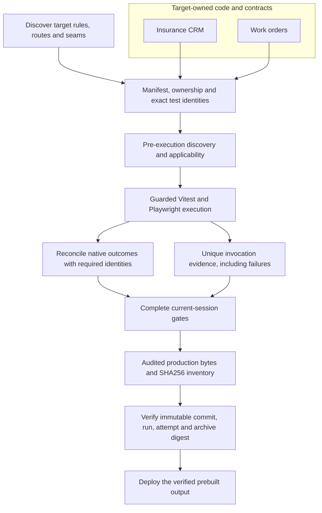
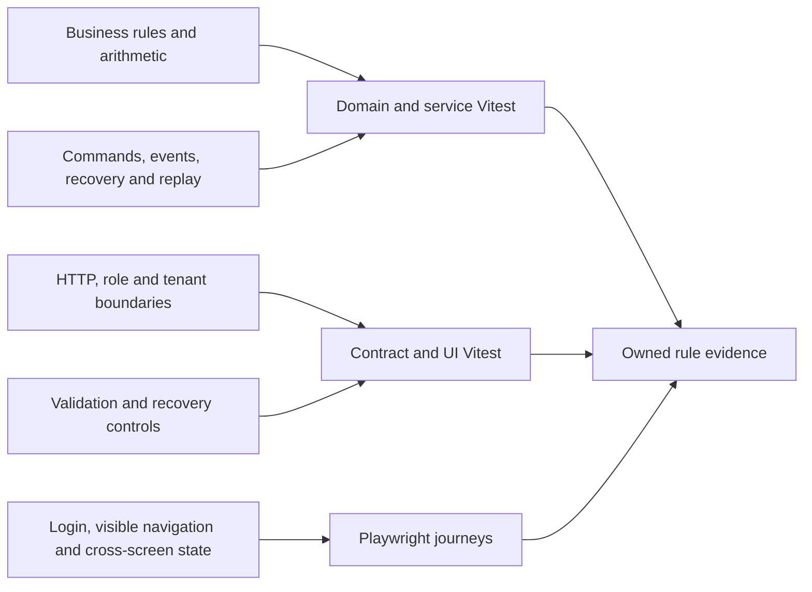
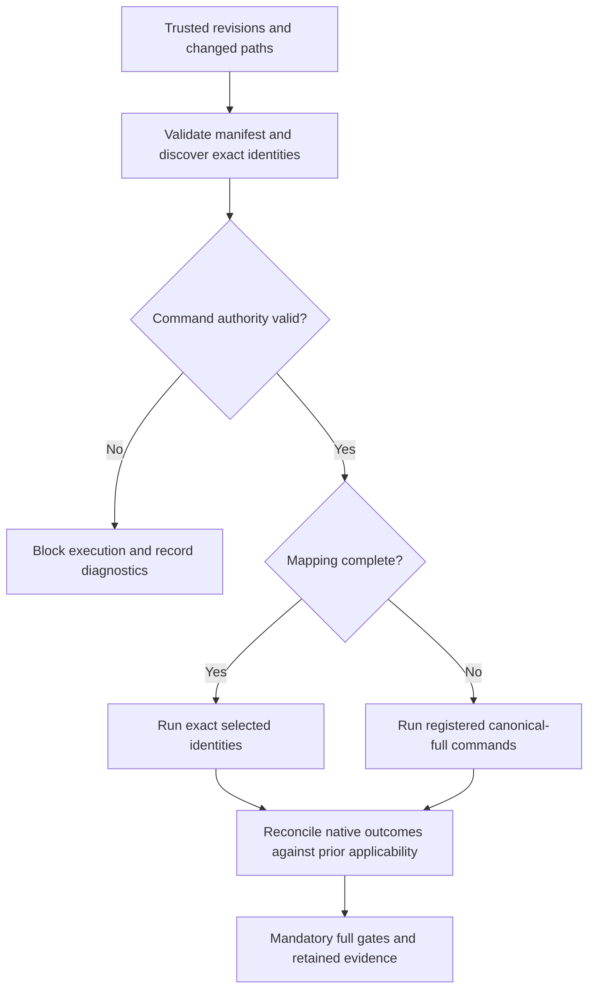

# Proofline technical guide

Companion to the [browser presentation](proofline-overview.html), [PDF](proofline-overview.pdf), and [audited measurements](measurements.json). The latest complete local verification ran at implementation **`4feb0572fb8aa1a18fcfdfa0e9f5333b59d714e2`**, against base/merge base **`cfe5f11630eac902210bce1999b7a34f9847d8fc`**, on 2026-11-05 UTC. The later documentation/evidence commit **`6324ffc`** passed record governance; it is distinct from the tested implementation head. These showcase edits are subsequent documentation.

The result is **536 unit tests in 49 files across 11 targets, 43 Chromium tests, and 18 successful completion steps**. This was real local execution under a synthetic CI identity. No hosted GitHub run, live-provider call, push, publication, or deployment occurred. [Distributed primary evidence](verification/README.md) retains checksums and original-source mappings.

## 1. Portable core, two independent applications

Proofline is a repository-native regression harness for React/Vite applications. An agent can discover rules, implement behavior, author tests, and review mappings. Repeated CI execution uses deterministic Node, shell, JSON, Vitest, and Playwright commands without an agent or model call.

The reusable assets are the manifest, validators, exact selection, guarded runners, native outcome verification, coverage/evidence governance, scenario lifecycle, and release verification. Application pages, rules, fixtures, adapters, and tests belong to each target. The CRM and unrelated [work-orders app](../../examples/work-orders/README.md) supply different target-owned implementations.



The CRM manifest declares **12 workspaces, 15 command definitions, 36 critical rules, and 154 rule/layer bindings pointing to 95 distinct required test identities**. Multiple bindings can prove different rules through one test; bindings are not additional tests. Delivery remains checked-in tooling and configuration. [Manifest](../../proofline.harness.json), [rule registry](../../test-impact/rules.json), [original design](../superpowers/specs/2026-10-28-portable-hybrid-workflow-harness-design.md), [hardening design](../superpowers/specs/2026-11-04-enterprise-verification-design.md).

## 2. What the four improvements guarantee

The [safeguards slide](proofline-overview.html#8) summarizes these implemented contracts.

| Improvement | Enforced behavior | Inspectable evidence |
| --- | --- | --- |
| Genuine required-test execution | Discover applicability first; require each bound identity to genuinely pass exactly once in its applicable project. | Native reports, Vitest task events, expected/observed reconciliation, full-unit aggregate. |
| Preserved failure artifacts | Allocate a unique output directory before every executing invocation; later or parallel commands cannot overwrite it. | Per-invocation logs/report/media, hash-linked index, real failure → success preservation demonstration. |
| Verified immutable release | Package audited production bytes only after complete current-run gates; verify trusted provenance and archive/file hashes before prebuilt deployment. | Release inventory, complete gate references, local directory and real ZIP verification, offline rejection tests. |
| Unrelated second application | Copy the core unchanged into a fresh repository; replace the product contracts and exercise the target's own workflow. | 31 core hashes, exact 2-unit/4-browser selection, ten independent target gates and recorded compatibility. |

The acceptance and review sequence is retained in the [hardening plan](../superpowers/plans/2026-11-04-enterprise-verification.md). All four tasks received independent spec and code-quality approval, followed by whole-change and final-evidence approval. A failed first fresh attempt is retained: a new helper branch threshold failed, tests were added, and the whole cleared-state chain restarted without lowering its baseline. [Authored execution history](../../test-impact/execution-record.jsonl).

## 3. Contracts and hybrid test ownership

`proofline.harness.json` is the executable authority. Version 1 declares structured `argv` and repository-relative `cwd`, workspaces, command keys, browser projects/origins, adapter paths, ownership, coverage, rule bindings, and matrix paths. Validation checks metadata without executing configured commands. Missing or ambiguous authority fails closed.

The additive execution fields remove CRM/Nx defaults from canonical execution:

| Manifest field | Target responsibility |
| --- | --- |
| `execution.unitBuildCommands` / `unitTargets` | Name prerequisites and explicit Vitest targets, including target-owned config/cwd. |
| `execution.browserBuildCommands` / `browserArgs` | Name prerequisites and a Playwright `test` command with explicit target-owned config. |
| `production.directory` / `forbiddenModules` | Identify production output and test-only modules that its audit must reject. |
| `ownership[].testBindings` | Bind rule/layer to stable ID, runner, command, exact file/full title and source line; optional browser tag. |
| `coverage` / lifecycle and golden matrices | Declare compatible per-file measurement and reviewable transitions/visible workflow evidence. Stateless targets use `lifecycleMatrix: null`. |

The schema stays version 1 for existing validator fixtures, but canonical execution and production audit require the relevant execution metadata. A non-Nx target needs no Nx binary. [Schema](../../tools/impact/src/harness-manifest.ts), [runner](../../tools/proofline/canonical-runner.mjs), [adaptation contract](../PORTABLE_TEST_AUTOMATION.md).



The CRM runtime composes Policy, Policy State, Finance and an in-memory bus. Its checkpoints preserve command receipts, envelopes, pending delivery, consumer receipts, generated IDs and service state. Recreation registers normal subscribers, hydrates state, then permits replay. Lost responses retain command identity; terminal rejections permit a new attempt. Deterministic tests prove exactly-once consequences for intake, bind, projections and ledger delivery. This is recovery evidence at an in-memory seam; a target supplies its own persistence integration. [Runtime](../../packages/insurance-runtime/src/runtime.ts), [tests](../../packages/insurance-runtime/src/runtime.test.ts).

The CRM flagship begins at a protected deep link, signs in, uses visible navigation for customer/property intake and quote/bind, checks policy/finance, logs out and proves denied revisit. Other rows cover accepted-response-lost recovery, Viewer denial, shared-runtime tenant isolation, and visible refund/correction. Adapters establish fixtures and inspect final invariants; they cannot perform an in-scope user action. [Workflow matrix](../../test-impact/workflows/crm-golden.json), [flagship](../../apps/crm-e2e/src/proofline/golden-workflow.spec.ts).

## 4. Selection followed by genuine runtime verification

Selection resolves complete Git history, checkout identity and a unique merge base. Raw Node hashing compares worktree bytes; restricted Git metadata/object operations cannot invoke filters or external helpers. Exact discovery ties changed path → owner → rule → test identity. Missing ownership, structural/config changes, stale or ambiguous bindings, unsupported imports or uncertain revisions broaden to registered canonical-full commands when command authority is valid. Invalid command authority blocks dispatch. Full CI gates remain required after narrow diagnostics. [Selection](../../tools/impact/src/select.ts), [governance](../../tools/impact/src/governance.ts).



Discovery alone never proves execution. A required identity must appear exactly once with the expected file, full title and applicable project, genuinely pass, and have expected status `passed`. Runtime skip/fixme/todo, expected-failure substitutions, retries/flaky outcomes, missing/duplicate results, malformed reports, wrong project and zero selected tests cannot satisfy it. Vitest native task events supplement JSON because JSON alone lacks sufficient expected-failure/retry/project metadata. Canonical full unit reconciles explicit children to catch an omitted target. The empty test-kit target is allowed only because it owns no required identities. [Reconciler](../../tools/proofline/execution-verification.mjs), [Vitest event reporter](../../tools/proofline/vitest-native-reporter.mjs), [negative cases](../../tools/proofline/src/required-execution.test.ts).

Latest native reconciliation proves **65 required unit identities within 536 genuine passes** and **30 required Chromium identities within 43 genuine passes**. Subset and shard applicability is determined before execution: the separate scenario gate requires 24 identities; each shard requires its own 12. Those are repeated tests already included in the full 43, so their counts must not be added. [Unit aggregate](verification/native/unit.verification.json.txt), [browser](verification/native/browser.verification.json.txt), [scenario](verification/native/browserScenario.verification.json.txt), [shard 1](verification/native/browserScenarioShard1.verification.json.txt), [shard 2](verification/native/browserScenarioShard2.verification.json.txt).

## 5. Failure evidence and execution identity

Every executing invocation receives `artifacts/proofline/runs/<unique-id>/` before spawn. It retains discovery, `native-report.json`, `verification.json`, stdout/stderr, Vitest `native-events.json` when applicable, and browser HTML/test artifacts. The append-only generated `artifacts/proofline/execution-index.jsonl` points to verification records by SHA256. A later run keeps earlier directories. Report/output overrides and effective coverage cleanup destinations cannot erase or collide with the protected execution root. CI uploads the root under `always()`. [Allocator](../../tools/proofline/execution-artifacts.mjs), [preservation tests](../../tools/proofline/src/execution-artifacts.test.ts), [CI workflow](../../.github/workflows/verify.yml).

A verification record binds version, invocation ID, source commit, exact argv/cwd, exit/outcome, expected/observed identities, errors, session, repository/workflow, CI run/attempt, gate key/execution ID, scope, project/worker/shard metadata, and aggregate child references. Release assembly requires successful complete gates from one current session/run/attempt; old same-SHA passes cannot be combined into a new approval.

A real browser runtime skip returned nonzero despite a nominally successful native command. A separate intentional browser failure produced report, trace, screenshots and video; a subsequent successful invocation left their SHA256 inventory unchanged. The [retained preservation result](verification/failure-artifact-preservation.json.txt) records both experiments. Media remains in the original local evidence; the compact showcase copy retains its inventory rather than distributing the entire failed-run report. This generated index is separate from authored `test-impact/execution-record.jsonl`; historical test-health analytics is outside this implementation.

## 6. Scenario isolation and production boundaries

Each Playwright worker starts a test-artifact server on an OS-assigned numeric loopback port. Each test owns a fresh BrowserContext and scenario runtime; contexts share one runtime only when explicitly requested inside that test. No mutable scenario or storage crosses tests, workers, shards or runs. Context-level auth/API/provider routes install before navigation and cleanup asserts no unexpected requests, including after failure. [Fixture](../../apps/crm-e2e/src/fixtures/test.ts), [scenario adapter](../../apps/crm-e2e/src/fixtures/scenario.ts).

The launcher creates a random startup capability; the server rejects missing, incorrect or replayed capabilities. Browser requests, workers, service-worker policy and WebSockets have explicit denial behavior. Runner/runtime preloads cover fetch, HTTP(S), WebSocket and inherited child execution before application modules load. Exact child executable/purpose/argv authority cannot broaden in descendants. A new egress plane requires a guard and denial test. These are reviewed application/test boundaries, not unrestricted OS sandboxing. [Guard policy](../../tools/proofline/guard-policy.mjs), [egress preload](../../tools/proofline/egress-guard.mjs).

Production and test builds use separate entrypoints. Production auditing inspects required module/Vite manifests and rejects test APIs, fake auth, seeded identities, mocks and capability markers. Tests never contact live providers. [Production audit](../../tools/proofline/src/production-negative.ts), [production entry](../../apps/crm-web/src/main.tsx), [test entry](../../apps/crm-web/src/test-entry.tsx).

## 7. Immutable production release

The [release slide](proofline-overview.html#9) follows the implementation in [bundle production](../../tools/proofline/release-bundle.mjs), [release evidence](../../tools/proofline/release-evidence.mjs), [archive validation](../../tools/proofline/release-archive.mjs), [release verification](../../tools/proofline/release-verify.mjs), and [deployment workflow](../../.github/workflows/deploy-demo.yml).

Verification publishes audited production bytes in Vercel Build Output format only after the entire required gate set, including standalone portability, multi-worker scenarios and both shards. Packaging rejects dirty tracked source, unsafe paths, symlinks, missing/substituted files and incomplete execution evidence. `release.json` includes a strict SHA256 inventory, immutable source commit, repository, workflow/run/attempt, gate outcomes and hash-linked execution references.

Published-release deployment resolves the tag to its immutable commit, checks out verifier tooling from the trusted default branch, and requires an unambiguous successful same-repository push/main run of the exact verification workflow. The artifact must belong to that run/attempt and remain unexpired. The trusted API digest is verified **before extraction**; safe extraction and strict inventory checks reject traversal, links, missing/extra members and changed bytes. Embedded provenance and complete gate evidence must match authority. Pinned tooling deploys the checked prebuilt output with `vercel deploy --prebuilt --prod`; source is not rebuilt at deployment.

The local smoke actually created and verified a **664-file inventory and 4,929,029-byte ZIP**, with matching directory/archive inventory and digest **`sha256:679961e6a970cfe5b5f809985af2572f00970981fea5b481d7eaa81ee67dc7b4`**. Its run `900000002`, attempt `1`, is explicitly synthetic. Offline tests cover wrong SHA/repository/workflow/attempt, stale or failed gates, expired/tampered artifacts, unsafe archives and dirty source. This validates local tooling and workflow contracts; it does not attest a hosted run or deployment. [Local result](verification/local-bundle-smoke.json.txt), [original inventory](verification/release.json.txt), [offline tests](../../tools/proofline/src/release-verification.test.ts).

## 8. The unrelated work-orders application

`pnpm proofline:validate-portability` creates a fresh disposable Git repository outside the host checkout, copies **31 reusable core files byte-for-byte**, adds target-owned files from `examples/work-orders`, and reuses installed third-party dependencies offline. It makes a real source change before discovery/selection; the result has no fallback and selects exactly **2 Vitest and 4 Playwright identities**. Full canonical execution separately verifies the same 2 unit and 4 Chromium tests; the browser run uses two workers. [Validation tool](../../tools/proofline/validate-portability.mjs), [result](verification/portability-result.json.txt).

The target uses dispatcher/observer roles, organization isolation, and `/desk/requests` → `/desk/completed` navigation. A dispatcher signs in, completes a seeded request through visible controls, follows the Completed link and sees the result. Other tests prove observer and organization denial. Its auth/API adapters, rules, lifecycle/golden matrices, configs, tests and production/test entrypoints are its own; it imports no CRM product code. Watch the [recorded second-app demo](proofline-overview.html#10) and inspect its [capture provenance](second-app-demo/README.md).

Ten target gates passed: static validation, typecheck, discovery, selected execution, full unit, full browser, coverage, coverage check, record check and production audit. The **target lifecycle source alone** has 31/31 lines, 5/5 functions, 19/19 branches and 31/31 statements; its UI and entire app are not claimed to have 100% coverage. [Target coverage](verification/standalone/coverage-summary.json.txt).

The tested compatibility is **Node 24.22.1, React 19.2.8, Vite 6.4.3, Vitest 3.2.7 and Playwright 1.62.1, on darwin-arm64 with Chromium**. These are observations of the executed combination, not an untested version/OS/browser support matrix. The demo capture is separate from the completion run and carries its own hashes.

## 9. Commands and completion evidence

Use the [exact manifest command table](../PORTABLE_TEST_AUTOMATION.md#canonical-command-contract) as command authority. These entrypoints expose its main operations:

| Command | Purpose |
| --- | --- |
| `pnpm harness:validate` | Validate the portable contract without executing configured commands. |
| `pnpm test:impacted -- --dry-run --base <base> --head <head>` | Explain exact selection or canonical-full fallback. |
| `pnpm test:impacted -- --base <base> --head <head>` | Execute diagnostics with runtime verification. |
| `pnpm test` / `pnpm e2e` | Full unit aggregate / full Chromium, with declared build prerequisites. |
| `pnpm coverage` / `pnpm coverage:check -- --base <base> --head <head>` | Produce compatible reports and enforce monotonic per-file thresholds. |
| `pnpm record:check -- --base <base> --head <head>` | Prove append-only history, fresh scoped evidence and generated rule/command parity. |
| `pnpm proofline:check-production` | Audit target-owned production output for forbidden test modules. |
| `pnpm proofline:validate-portability` | Run the unrelated disposable-repository adaptation. |
| `node tools/proofline/release-bundle.mjs` | Package only with the workflow's complete current-run identity/outcomes and execution evidence. |

The original Task 8 chain remains required:

```sh
pnpm lint && pnpm typecheck && pnpm harness:validate &&
pnpm test:impacted -- --dry-run && pnpm test:impacted &&
pnpm test && pnpm e2e && pnpm coverage && pnpm coverage:check &&
pnpm record:check && pnpm proofline:check-production && git diff --check
```

Set `IMPACT_BASE` and `IMPACT_HEAD` to trusted revisions before revision-sensitive commands. The latest cleared-state run additionally executed the manifest's `browserScenario`, `browserScenarioShard1` and `browserScenarioShard2` argv, standalone portability, packaging, and directory/real-ZIP verification: **18 steps, each exit 0**. Generated build/cache/report/test outputs were cleared first; installed dependencies were retained. The retained controller interval was 595.990 seconds. [Step outcomes and exact argv](verification/full-gate-state.json.txt), [results slide](proofline-overview.html#12).

Coverage comparison anchors to the merge-base manifest and baseline. Missing reports/metrics, incompatible provider/version/groups, unclassified sources, deleted critical entries or lowered thresholds fail. Authored JSONL must preserve the byte-exact base prefix, append fresh overlapping scopes, and end in exactly one LF. Old evidence cannot authorize a new governed change. [Coverage policy](../../tools/impact/src/coverage-policy.ts), [record checker](../../tools/impact/src/record-check.ts).

## 10. Reading coverage and timing honestly

The display bars sum covered/total line counters within each classified group. The gate enforces **every classified file and all four metrics**; an aggregate percentage cannot substitute for that check.

| Presentation component | Classified files | Covered / total lines | Line coverage |
| --- | ---: | ---: | ---: |
| Event delivery | 1 | 163 / 163 | 100.0% |
| Policy commands | 1 | 349 / 354 | 98.6% |
| Policy projections | 1 | 153 / 166 | 92.2% |
| Finance | 1 | 479 / 479 | 100.0% |
| Workflow runtime | 1 | 1,191 / 1,238 | 96.2% |
| API contracts | 1 | 264 / 285 | 92.6% |
| Harness governance | 2 | 531 / 548 | 96.9% |
| Harness + release tools | 15 | 2,636 / 3,600 | 73.2% |

The eight groups now classify **23 files**, compared with 12 in the historical snapshot. All original 12 file thresholds remain unchanged. Group membership expanded; aggregate percentages across the two snapshots are not a like-for-like improvement measure. Current classified counters total 5,766/6,833 lines (84.38%); all eleven produced workspace reports total 15,242/17,710 (86.06%). Neither is whole-product quality or browser coverage. Tests, barrels, fixtures and other out-of-group sources carry explicit exclusions. Some runner/reporter paths execute only in subprocesses and show zero under parent instrumentation; real child-process regressions prove their behavior separately. The portability helper has **256/256 measured branches**, while its other metrics are below 100%; that does not make the entire core fully covered. [Raw counters, exclusions and ratchet](verification/README.md), [measurements](measurements.json).

| Latest observation | Native reporter duration | Complete command wall duration |
| --- | ---: | ---: |
| Full 43-test Chromium suite | 20.393s | 28.063s |
| Separate 24-test scenario gate | 3.757s | 4.531s |
| 12-test shard 1 / shard 2 | 2.744s / 2.238s | 3.509s / 2.998s |
| Full unit command | Per-target durations retained | 153.397s |
| Coverage command | Instrumented workload | 152.395s |
| Standalone validation | Ten different gates | 20.086s |

For focused unit-layer context, the direct finance target's reporter duration was 0.231s, runtime 0.263s, and API contracts 0.321s; those are subsets of canonical unit, not independent completion gates. Browser timings come from native `stats.duration`; unit durations use the final top-level child reporter line. Builds/setup belong to the separate command wall measurement. These are different workloads on one local machine, with no speedup claim. [Timing extraction and source hashes](verification/native/timing-extract.json.txt).

## 11. Historical demonstrations and current limits

The [regression demonstration](bug-demo/README.md) is a historical controlled mutation in a disposable copy at contextual source commit `90987ce`. The unchanged FIN-002 test creates a $25 deposit, expects no deposit commission and separately verifies settled-premium commission. Expanding the condition to include deposits makes the existing test fail on a 250-cent accrual; restoring the original condition passes the identical test, and the restored finance file passes 24 tests. Baseline → injected regression → developer restoration uses identical selected argv/test bytes. The slide replays retained output; it does not run or repair code in the viewer. [Results and hashes](bug-demo/results.json).

The [CRM video provenance](demo/provenance.json) binds its earlier capture to actual source/build hashes; its contextual HEAD is not a clean-HEAD attestation. Its recorded 35.7s presentation-paced workflow and the regression's subsecond focused runs are separate observations from the latest completion gate. The complete original `4dc77a6` measurements, including its 404-unit-test count, 12-file coverage scope and two official passes, remain under `historicalSnapshots.originalPortableCompletion` in [measurements.json](measurements.json).

Chromium owns the complete tested browser matrix. Firefox/WebKit have opt-in invariant-smoke definitions and no new executed-support claim. Cancellation and commission payment still lack visible reference controls and retain deterministic service evidence. The reference `refreshToken` is a refresh-capability marker rather than an independently authenticated credential. Git 2.48+ is required. A reviewed loopback probe-to-child-bind race may fail startup closed. Live-provider integration, production database durability, exhaustive browser states, OS sandboxing, security scanning, mutation/load testing and hosted health analytics remain outside the demonstrated scope. [Portable contract and limits](../PORTABLE_TEST_AUTOMATION.md).

For adoption, inventory the target first, replace its product contracts/adapters/tests, keep the portable core unchanged, write failing behavior tests before implementation, review both spec compliance and code quality, append evidence, and run every full gate from fresh generated state. [Work-orders example](../../examples/work-orders/README.md) is the concrete adaptation reference.

The editable presentation is [proofline-overview.html](proofline-overview.html); the [Node exporter](build_overview.mjs) produces its PDF with local Playwright Chromium. [Design sources and rebuilding](DESIGN_SOURCES.md) records media/font licenses and playback. Mermaid blocks above remain editable source.
